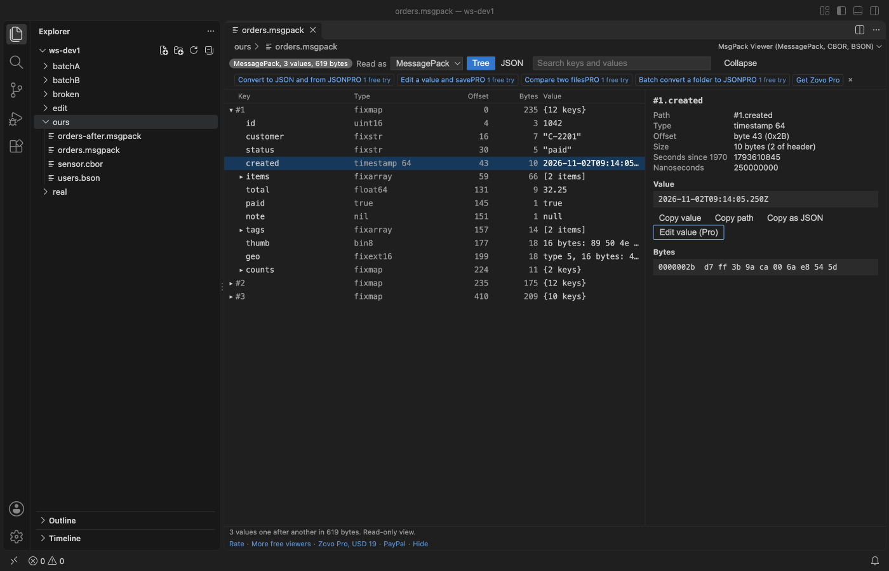

# MsgPack Viewer & BSON, CBOR

Open MessagePack (.msgpack, .mpk), BSON and CBOR files in VS Code as a tree of values with their types, sizes and byte offsets, and see any value as JSON. Made by Zovo.

Free, with no account and no network calls:

- Opens .msgpack, .mpk, .bson and .cbor files as a tree: each value with its wire type (fixmap, uint16, str8, int64, decimal128, tag 1 and so on), its byte offset and its size. Children load as you open them, 500 at a time, so large files open fast.
- Reads files that hold many values one after another: MessagePack streams, CBOR sequences and BSON dumps with one document after another. Each value shows as #1, #2, #3.
- Shows the special types clearly: MessagePack ext types and timestamps, CBOR tags (dates, bignums, UUIDs, URIs), BSON ObjectIds with their creation time, UTC dates, decimal128, binary with its subtype, regular expressions and timestamps. Binary data shows as hex.
- A JSON view of the selected value or of the whole file, with Copy JSON. Copy value and Copy path for any value.
- Search keys and values anywhere in the file. A click on a match opens it in the tree.
- Bad data never crashes the view: a note names the byte offset and what is wrong there, every value before it still shows, and the damaged value is marked so you can open it and see how far it reads. A file that is really JSON text or a Git LFS pointer gets a plain note.
- Read as: open the bytes as another of the three formats. Open a File as MessagePack, CBOR or BSON (Command Palette) opens a file with any other name.

Zovo Pro: USD 19 once, for the Pro tools in every Zovo extension. Each Pro tool has 1 free try on your computer first:

- Convert to JSON and from JSON: save a file as plain JSON (readable), typed JSON (it converts back to the same types), JSON Lines, or one of the other two formats, and turn a JSON or JSON Lines file into MessagePack, CBOR or BSON.
- Edit a value and save: change one value (text, number, boolean, null, date, ObjectId, decimal, binary) and write it back to the file in the same format, or to a copy. Every other value keeps its exact bytes (in BSON, the lengths of the documents around it are updated).
- Compare two files: a structural comparison of two files, also across formats. It lists keys added and removed, changed values and changed types with their paths, and saves the list as a Markdown report.
- Batch convert a folder to JSON: every .msgpack, .mpk, .cbor and .bson file in a folder (and its subfolders if you like) gets a JSON file next to it, with a result line per file.

## How to use it

- Click a .msgpack, .mpk, .cbor or .bson file. It opens in the viewer. The first value opens by itself.
- Click a value to see its details on the right: the path, the type, the offset and size, the full value and its first 256 bytes in hex. The arrow keys move through the tree.
- Click JSON in the toolbar to see the selected value as JSON. Copy JSON copies all of it (up to 50 MB), even when the view shows only the first 2 MB.
- Type in the search box to find keys and values. Click a match to go to it.
- To try it without your own files, run MsgPack Viewer: Open a Sample File from the Command Palette. Samples open as copies, so an edit changes nothing in the extension.
- The Pro tools are in the Command Palette (MsgPack Viewer: ... (Pro)), in the Explorer right-click menu of these files, in the viewer's title bar menu and in the small row at the end of the viewer toolbar. Edit value (Pro) is also a button in the details of a value. The row closes with its x for the rest of the session, and the setting `msgpackViewer.showProTools` hides the Pro tools.

## Typed JSON

Plain JSON is for reading: binary data becomes base64 text, dates become ISO 8601 text and ObjectIds become hex text. Typed JSON keeps every type, so it converts back: dates as `{"$date": "..."}`, binary as `{"$binary": {"base64": "...", "subType": "00"}}`, BSON int64 as `{"$numberLong": "..."}`, ObjectIds as `{"$oid": "..."}`, decimals as `{"$numberDecimal": "..."}`, MessagePack ext types as `{"$ext": {"type": 5, "base64": "..."}}`, CBOR tags as `{"$tag": 1, "value": ...}`, and maps with keys that are not text as `{"$map": [[key, value], ...]}`. Integers stay integers and floats keep a decimal point, so 1 and 1.0 come back as they were.

Converting between formats keeps every value. A type the target format has no form for (a BSON ObjectId in MessagePack, a MessagePack ext type in BSON) is written as its typed JSON map. BSON stores dates in milliseconds, so finer parts of a MessagePack timestamp are dropped there.

## Privacy

The extension reads the file you open and nothing else. It makes no network calls, and nothing is uploaded or measured. The Pro tools write only the files you ask for. The links at the bottom of the viewer (Rate, More free tools, Zovo Pro) open a page only when you click them, and the setting `msgpackViewer.showSupportLinks` hides them.

## Settings

| Setting | Default | What it does |
|---|---|---|
| `msgpackViewer.showProTools` | true | Shows the Pro tools in menus, the palette and the toolbar row. |
| `msgpackViewer.showSupportLinks` | true | Shows the Rate, More free tools and Zovo Pro links. |
| `msgpackViewer.askForRating` | true | Asks once for a rating after two good uses at least 30 minutes apart. |
| `zovo.msgpack.trial.enabled` | true | Shows the 7-day Zovo Pro trial button in the Pro panel. |

## Zovo Pro

One payment of USD 19 unlocks the Pro tools in every Zovo extension on your computers; a team of 5 is USD 59. The key works offline. Run Zovo Pro: Get Zovo Pro from the Command Palette. The Zovo Pro tab lists this extension's Pro tools and your free tries before any payment page opens. When a free try is used, the Pro panel also offers a 7-day trial of all Pro tools, with no card and no account; it starts only when you click its button.
